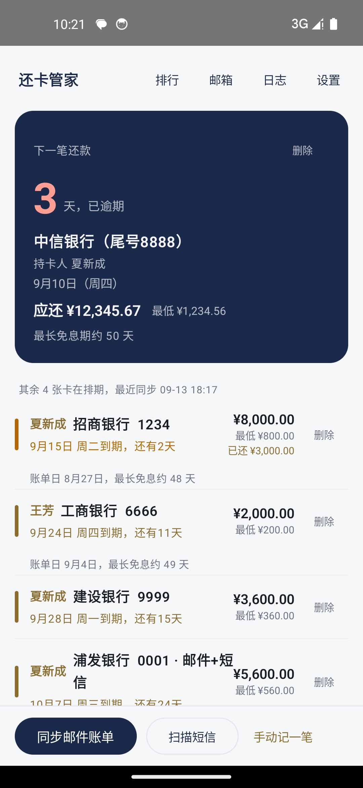
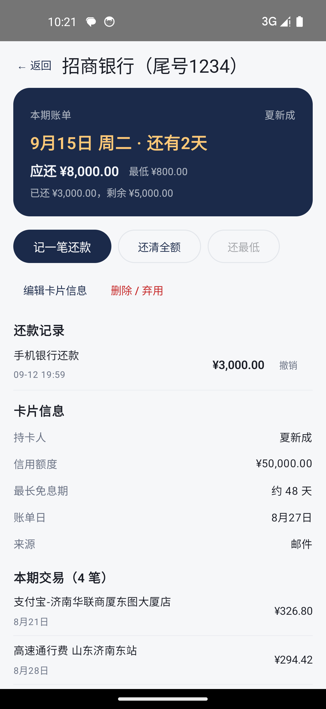

# 还卡管家 CardKeeper

一个**纯本地**的安卓信用卡账单管家：自动从邮箱拉取各银行账单邮件，解析出还款日、应还金额、持卡人、额度，在还款日前推送通知，防止逾期。灵感来自 51 信用卡管家，但数据只存在你自己的手机上，不上传任何服务器。

<p align="center">
  
  &nbsp;&nbsp;
  
</p>

## 功能

- **多邮箱 IMAP 直连**：163/126/QQ/Foxmail/139/sina/sohu/aliyun/outlook 自动匹配服务器，其他邮箱可手填；兼容 163 要求的 IMAP ID 命令握手
- **账单解析**：银行名称、卡号尾号、持卡人、还款日、账单日、全额/最低应还款、信用额度；支持 HTML 表格、双语对照、列式表格、双币账单（自动取人民币）、掩码卡号等各家版式
- **短信补充**：可选读取近 100 天银行短信，与邮件来源按「银行+尾号+账期」字段级合并
- **还款管理**：记一笔还款 / 还清全额 / 还最低，记录可撤销；还清的卡自动沉底不再提醒
- **排行页**：按免息期长度、额度排序
- **账单历史与交易明细**：每张卡可看往期账单和本期交易记录（还款为负数显示）
- **弃用卡**：删除时可勾选「已弃用」，以后再收到该卡账单自动跳过
- **提醒**：还款日前 N 天（默认 3 天）每天通知；每日 9 点 WorkManager 后台同步，打开 App 立即检查
- **安全**：授权码用 AndroidKeyStore（AES-256-GCM）加密存储；严格 TLS 证书校验；不允许明文流量；禁用系统备份；数据零上传

## 技术栈

Kotlin · Jetpack Compose (Material 3) · Room（含 5 版schema迁移） · WorkManager · Jakarta Mail (IMAP) · pdfbox-android（PDF 账单）

核心解析逻辑在 [`app/src/main/java/com/juxi/cardkeeper/parse/BillParser.kt`](app/src/main/java/com/juxi/cardkeeper/parse/BillParser.kt)：基于「标签 + 带闸门间隔」的正则组 + 交易行状态机，配合 27 个单元测试（含 12 个真实账单端到端用例）。

## 构建

需要 JDK 17、Android SDK 34：

```bash
git clone https://github.com/<你的用户名>/CardKeeper.git
cd CardKeeper
./gradlew assembleDebug          # 产物 app/build/outputs/apk/debug/
./gradlew testDebugUnitTest      # 跑解析器测试
```

### 签名（可选）

正式签名的 keystore 与密码**不入库**。如需构建签名版，在工程根放两个被 `.gitignore` 排除的文件：

- `cardkeeper-release.jks` —— 你的 keystore
- `signing.properties`：

```properties
storePassword=你的store密码
keyAlias=你的alias
keyPassword=你的key密码
```

没有这两个文件时 `assembleRelease` 照常构建，产物为未签名 APK。

### 真实账单样本（测试用）

`RealMailParseTest` 依赖本地 `邮件样本/*.eml`（真实账单导出，因含个人信息**不随仓库分发**）。把任意银行账单邮件原文存为 .eml 放进该目录（或设置环境变量 `CK_SAMPLE_DIR` 指向它），用例即自动启用；没有样本时这些用例自动跳过，不影响其余测试。

## 隐私与免责声明

- 本项目**不包含任何开发者个人的账单、邮箱凭证或签名密钥**（构建前已脱敏）
- App 本身不申请网络权限以外的敏感权限；数据全部留在设备本地
- 各银行邮件版式会不定期改版，解析规则可能需要按你收到的账单自行调整；「日志」页有每封邮件的解析结果便于排查
- 仅供学习与个人使用，请以银行官方渠道的账单和还款信息为准

## License

[MIT](LICENSE)
